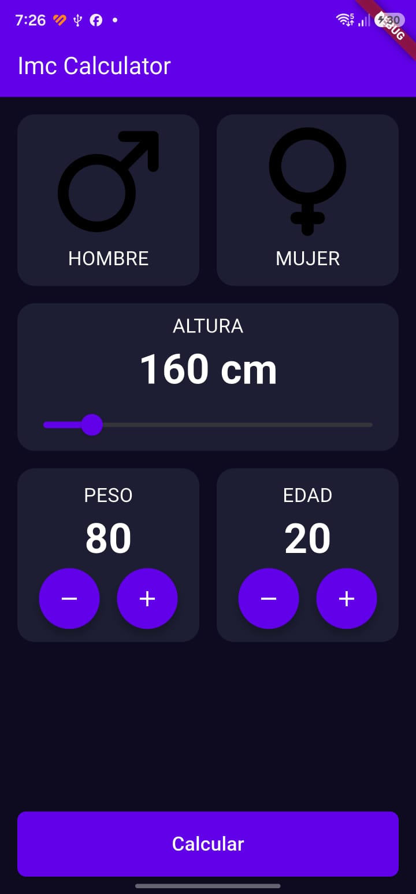

# Calculadora de IMC

Una aplicación móvil sencilla desarrollada con Flutter para calcular el índice de masa corporal (IMC) a partir del peso y la estatura.

Este proyecto forma parte de mi aprendizaje de Flutter. Lo estoy construyendo paso a paso para practicar el desarrollo de interfaces, el manejo del estado y la navegación entre pantallas.

## Capturas de pantalla

| Inicio | Resultado |
|:--:|:--:|
|  |  |

## Ejecutar el proyecto

Con Flutter instalado, descarga las dependencias y ejecuta la aplicación:

```bash
flutter pub get
flutter run
```
